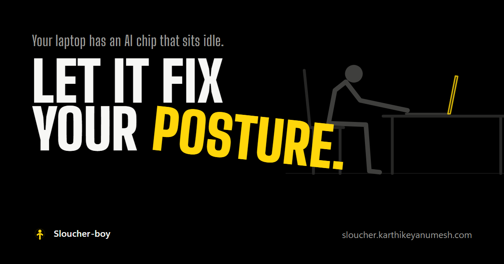
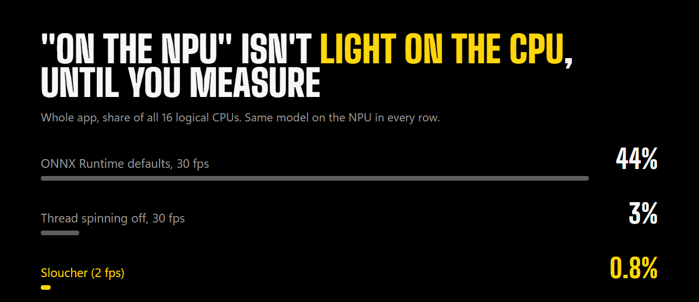
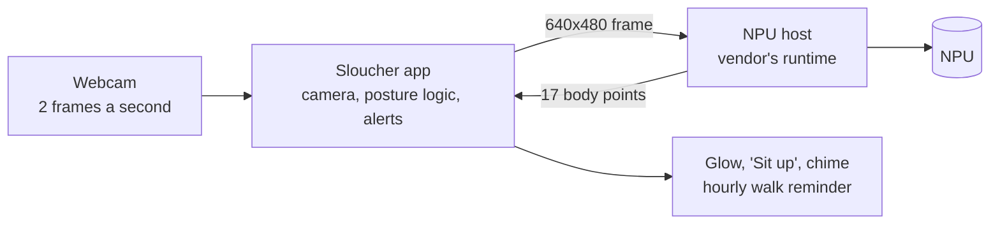

<p align="center">
  
</p>

<p align="center">
  <a href="https://github.com/naraianlegrand/sloucher_ai/releases/latest"></a>
  <a href="LICENSE"></a>
  <a href="https://github.com/naraianlegrand/sloucher_ai/actions/workflows/tests.yml"></a>
  
  
  
</p>

<p align="center">
  <a href="https://github.com/naraianlegrand/sloucher_ai/releases/latest"><b>Download</b></a> ·
  <a href="https://sloucher.karthikeyanumesh.com">Website</a> ·
  <a href="https://sloucher.karthikeyanumesh.com/story/">How it was built</a> ·
  <a href="docs/INSTALL.md">Install</a> ·
  <a href="docs/PORTING.md">Bring it to your NPU</a>
</p>

# Sloucher

Recent laptops ship with an **NPU**, a chip built to run AI efficiently, and on most of them it does almost nothing.
Sloucher puts it to work. It watches your face and shoulders through the webcam, all day, at **about 1% of the CPU**.
When you've slouched, leaned in or stared down at your phone for most of 30 seconds, the edges of your screen glow and a
small **"Sit up"** appears. Sit up, and it's gone. Once an hour, it gets you out of the chair, and it knows if you came
back too early: *"Not done yet: 18 s left."*

Your video never leaves your laptop: each frame becomes 17 body points on the NPU and is then thrown away.

## Why the NPU

Almost every webcam AI project runs on the CPU. For something that runs all day, that means fan noise, heat, battery
and a slower laptop. The NPU is built for exactly this kind of small, constant model. But putting a model on the NPU
isn't the end of it:

<p align="center"></p>

With the model already on the NPU, ONNX Runtime's default thread pool still kept **7 CPU cores** busy waiting.
One setting took it to 3%; looking twice a second instead of 30 times took the whole app under 1%.
[The full story](https://sloucher.karthikeyanumesh.com/story/) has the eight things that broke on the way.

## The numbers

Measured on an AMD Ryzen 7040 laptop (Phoenix NPU, 16 logical CPUs):

| | |
|---|---|
| Model operators on the NPU | **96.5%** (1,042 of 1,080, INT8 YOLOv8n-pose) |
| Time per frame on the NPU | **12-17 ms** |
| Whole app, camera included | **0.8% CPU**, ~480 MB |
| Shoulders found in the right place at a desk | **100%** of frames in every front-facing test clip (MoveNet: ~0%) |
| Slouch, lean-in and head-down clips that alert | **3 of 3**, and no false alarm on the 6 good clips |
| Installer | **39 MB**, no admin rights |

## How it works



Posture is two ratios of your own face and shoulders, compared with your calibrated "sitting tall", so it works whether
you sit close to the screen or far from it. Details: [docs/ARCHITECTURE.md](docs/ARCHITECTURE.md).

**NPU-only, on purpose.** If the model can't run on the NPU, Sloucher says so and stops. It never quietly falls back to
the CPU.

## Supported laptops

| NPU | Status |
|---|---|
| AMD Ryzen 7040 / 8040 (Phoenix, Hawk Point) | **Out now** |
| AMD Ryzen AI 300 (Strix, Krackan) | Next: needs a tester |
| Intel Core Ultra | Coming (OpenVINO) |
| Snapdragon X | Coming (QNN) |
| Apple Silicon | Coming (a native Mac app) |

**Have one of the "coming" laptops?** [Open an issue](https://github.com/naraianlegrand/sloucher_ai/issues/new) with
your laptop model: a tester with real hardware is what moves a port forward. How a port works: [docs/PORTING.md](docs/PORTING.md).

## Install

**[Download the latest installer](https://github.com/naraianlegrand/sloucher_ai/releases/latest)** (`SloucherSetup-x.y.z.exe`, 39 MB).

You need Windows 11, an AMD Ryzen 7040 or 8040, and AMD's Ryzen AI Software 1.6.1 (a one-time install from AMD).
Step by step: [docs/INSTALL.md](docs/INSTALL.md).

## Run from source

```
pip install -e .[dev]
python -m sloucher doctor     # checks the NPU, driver, runtime, model and camera, and tests the NPU
python -m sloucher            # the tray app
python -m sloucher --demo     # preview the alerts, no camera or NPU
pytest
```

Build the installer: `packaging\build.ps1 -Python <python.exe>` (PyInstaller + Inno Setup).

## Website

**[sloucher.karthikeyanumesh.com](https://sloucher.karthikeyanumesh.com)**: what Sloucher does, in English and French.

- [How it was built](https://sloucher.karthikeyanumesh.com/story/): the SDK that quietly ran on the CPU, the model
  that couldn't see me, and the NPU app that burned 7 CPU cores.
- [Extra resources](https://sloucher.karthikeyanumesh.com/extra/): every measurement, and a checklist for building
  your own app on the NPU.
- [Privacy](https://sloucher.karthikeyanumesh.com/privacy/)

## Help it grow

If Sloucher made you sit up, a ⭐ helps other people find it. Bugs and ideas go in
[issues](https://github.com/naraianlegrand/sloucher_ai/issues); what's planned is in the
[milestones](https://github.com/naraianlegrand/sloucher_ai/milestones). To contribute: [CONTRIBUTING.md](CONTRIBUTING.md).

## Licence

[AGPL-3.0](LICENSE). The pose model is Ultralytics YOLOv8n-pose (AGPL-3.0), quantized to INT8 for the NPU. Privacy:
[docs/PRIVACY.md](docs/PRIVACY.md).

Made in Montréal, Canada, by [Karthikeyan Umesh](https://karthikeyanumesh.com).
